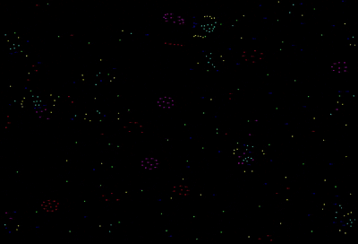

# Particle Simulation Project

A simplified real-time particle simulation built with Python and Pyglet. This project simulates life-like behaviors and patterns using only simple mathematical attraction and repulsion forces (pull/repel) between different groups of colorful particles.



---

## What it features

* **Real-Time UI Sidebar:** Tweak parameters, particle counts, and attraction matrix inside the running application.
* **Attraction Matrix:** Manually adjust a custom grid of interactions to dictate how color groups attract or repel one another.
* **Performance Optimized:** Uses OpenGL-accelerated rendering batches to maintain smooth performance with hundreds of particles.

---

## Installation & Setup

### Prerequisites
Make sure you have Python 3 installed on your system.

### 1. Clone the Repository
```bash
git clone https://github.com
cd YOUR-REPOSITORY-NAME
```

### 2. Install Dependencies
Install the required graphics library using pip:
```bash
pip install pyglet
```

### 3. Run the Simulation
```bash
python main.py
```

---

## How to Control & Customize

The user interface sidebar gives you full control over the laws of physics:

### Physics Parameters
* **n:** Total number of particles active in the environment. (1-5000)
* **m:** Total number of colors that particles can have. (1-6)
* **dt:** The time-step factor, controlling the overall speed of the simulation. (no limit)
* **frictionHalfLife:** Prevents absolute chaos by stabilizing movement over time. (no limit)
* **forceFactor:** Multiply the calculated forces by this number to speed up effects. (no limit)
* **rMax:** The maximum interaction radius; how far a particle's field of influence reaches. (no limit)
* **beta:** The close-range repulsion threshold to keep particles from collapsing into single points. (0-1 float)
* **particleRadius:** Visual scale and size of individual dots. (1-20)

* **Attraction Matrix:** Change how each color particle behaves with another from -1 (repel) to +1 (attract). (1x1-6x6)
Each row or column is associated with a color: 1=Red, 2=Yellow, 3=Green, 4=Cyan, 5=Blue, 6=Magenta

### Customizing Behaviors
1. Click any value box in the sidebar or matrix.
2. Type your value (Matrix entries take inputs between -1.0 and 1.0).
3. Press Enter or click the "Apply values" button to rewrite physics rules on the fly.

---

## Under the Hood

### Force Calculation
The simulation relies on a custom distance-based force curve:


* **Close Range:** Universal repulsion forces apply to prevent overlapping particles.
* **Mid Range:** Governed by the custom attraction matrix, pulling similar or opposing colors together based on your settings.
* **Long Range:** Dropoff zones where the relative force returns to zero.

### Periodic Boundary Conditions
The environment maps as a wrapping screen loop. Particles exiting a boundary reappear seamlessly on the opposite side.
